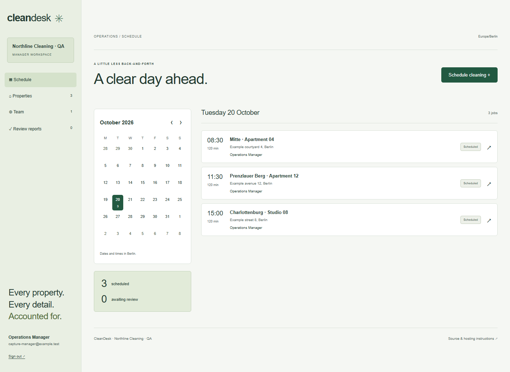

# CleanDesk

A small, self-hosted workspace for cleaning teams managing several apartments. Managers assign visits in a calendar; cleaners work through property checklists, attach completion photos, and submit reports for review.

This is a server application with a real SQLite database, password authentication, and private file storage. It starts empty. There is no demo account, seeded property, simulated upload, or demo mode.



## The working flow

1. The first manager creates a workspace and selects its European time zone.
2. The manager adds properties, addresses, private access notes, and a checklist for each property.
3. A one-time invitation lets each cleaner create their own account and password. Invitations expire after 24 hours.
4. The manager schedules a visit, chooses its duration, and assigns a team member. Overlapping visits for the same property or person are rejected.
5. The cleaner sees only their assigned jobs and properties, starts a visit, completes its checklist, writes a report, and uploads photos.
6. Submitting requires a completed checklist and at least one photo. Submitted reports are locked.
7. The manager approves the clean or reopens it with feedback. Status changes retain an actor and timestamp history.

The calendar, job times, and reports use the workspace time zone. Nonexistent or ambiguous daylight-saving transition times are rejected rather than silently moved to another time. Managers can also assign themselves a visit.

## Run locally

Use Node.js 24 LTS and npm. The SQLite flag in the scripts also supports older Node 22 installations.

```sh
npm ci
cp .env.example .env.local
npm run dev
```

Open `http://localhost:3000` and create the first manager account. On PowerShell, use `Copy-Item .env.example .env.local` for the copy step.

The local defaults store `cleandesk.sqlite` and processed photos under `data/`. That directory, test data, and environment files are ignored by Git. Set `APP_ORIGIN` to the exact URL used to open the application. The development setup key is optional; if you configure `SETUP_TOKEN`, the first manager must enter it.

```sh
npm run lint
npm test
npx playwright install chromium
npm run test:e2e
npm run build
npm start
```

Browser tests use a separate `.test-data/` database and disposable test accounts. They do not populate a normal installation. `test-results/` is ignored by Git.

## Host it for a team

CleanDesk needs a persistent Node server. GitHub Pages cannot run its login, database, or private uploads. No public application server is provisioned by this repository.

Set these runtime variables for production:

```dotenv
APP_ORIGIN=https://cleaning.example.com
DATA_DIR=/data
COOKIE_SECURE=true
SETUP_TOKEN=replace-with-a-long-random-setup-key
```

Use your own HTTPS domain and a secret setup key. Production bootstrap requires the configured key, preventing an anonymous visitor from claiming a fresh installation. Once a workspace exists, the setup endpoint cannot create another manager. Keep the origin equal to the public application URL, including its port when applicable.

A Dockerfile is included:

```sh
docker build -t cleandesk .
docker run -d --name cleandesk --restart unless-stopped \
  --env-file .env.production.local \
  -p 127.0.0.1:3000:3000 \
  -v cleandesk-data:/data cleandesk
```

Put the production variables in the ignored `.env.production.local` file, and put an HTTPS reverse proxy in front of port 3000. The container runs as the unprivileged `node` user. Use one application instance per database; this version is intended for a small team, not multiple app replicas.

Back up the complete data directory, including photos. Stop the application before copying the database and files together, then restart it. Restore the complete directory to the same configured volume. Do not put customer records or the data volume in a public Git repository.

### Password recovery

A server administrator can reset a forgotten password locally; there is no email reset service:

```sh
node --env-file=.env.local --experimental-sqlite scripts/reset-password.mjs account@example.com
```

The command reads the new password without echoing it and revokes existing sessions for that account. In a container, run the script with `docker exec -it cleandesk node --experimental-sqlite scripts/reset-password.mjs account@example.com`.

## Access and files

Passwords use salted scrypt hashes. Opaque session tokens are hashed in SQLite and sent in HttpOnly, SameSite=Strict cookies. Production cookies use Secure. Each mutation checks the request origin. Failed sign-ins are rate limited by account and globally on the server. Every job and photo operation checks the current account and assignment.

Uploads have a streamed request limit and a 5 MB file limit. Images are decoded with a pixel limit, oriented, resized, re-encoded as WebP, and stored without source EXIF metadata. Reports allow up to 12 photos. Photos are served through an authenticated endpoint with private/no-store caching, never from `public/`. Upload size and decoding failures are reported to the user.

This release has one workspace per installation, manager and cleaner roles, and online-only reporting. It does not include billing, customer logins, recurring bookings, email delivery, browser push, payroll, or cross-company tenancy. Properties and completed reports are retained; there is no destructive bulk deletion interface. Operational access notes and reports are plain text, not encrypted at rest; protect the server and its backups accordingly.

## Implementation and checks

Next.js App Router, React, JavaScript, Node SQLite, sharp, and the Temporal polyfill. `lib/store.js` owns transactions, role checks, schedule conflicts, state transitions, and sessions. `lib/http.js` bounds request bodies and checks origins. Route handlers expose the authenticated API. Components handle calendar navigation, administration, and reports.

Unit/integration checks exercise the full database lifecycle, assignments, private photos, immutable submissions, manager review, persistence, session revocation, daylight-saving boundaries, body limits, and sign-in throttling. Browser tests use two separate accounts to create, assign, complete, photograph, submit, and approve a visit on desktop and mobile. Accessibility and layout checks cover the manager workspace. The Dockerfile is supplied; verification was performed with Node directly, not a Docker daemon.

Optional Google Fonts have local fallbacks. The application sends no email or external notifications. MIT license.
